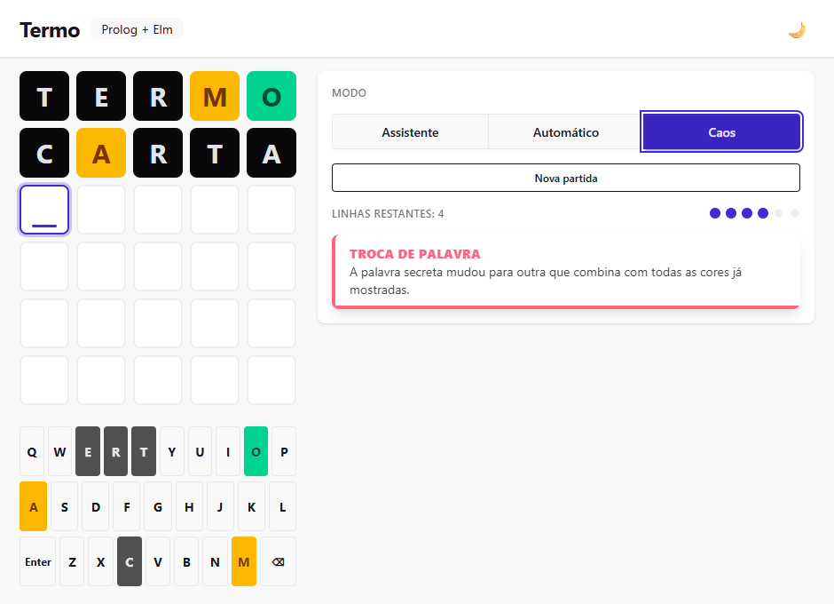

<!--
  TEMPLATE DO RELATÓRIO DE ENTREGA: Paradigmas de Programação

  Como usar:
  - Copie este arquivo para a raiz do repositório do grupo, com o nome
    RELATORIO.md, e preencha todas as seções.
  - Os textos entre <!- - e - -> (como este) são instruções. Eles não
    aparecem quando o arquivo é visualizado, mas APAGUE-OS antes de entregar.
  - Troque tudo o que estiver entre [colchetes].
  - Seja direto. Frases curtas e listas valem mais que parágrafos longos.
    Um relatório típico cabe em 4 a 8 páginas.
  - O relatório e o código são avaliados juntos. Sempre que possível,
    aponte para o código (arquivo e linha) em vez de descrevê-lo. Os
    critérios de avaliação estão em AVALIACAO.md.
  - ANTES DE ENTREGAR, rode o validador na raiz do repositório:

        uv run scripts/validar_entrega.py

    Ele confere a FORMA do relatório (comentários apagados, colchetes
    preenchidos, tabelas bem formadas, seções presentes, arquivos
    existentes), não o conteúdo. Corrija todos os ERROS apontados.
-->

# [Nome do projeto]

## 1. Identificação

<!--
  Os grupos têm de 3 a 7 pessoas (5, em média). A tabela abaixo tem 5
  linhas: adicione ou remova linhas conforme o tamanho do seu grupo, aqui e
  na seção 10. Os grupos podem misturar alunos das turmas das 14h e das 16h:
  indique a turma de CADA integrante.
-->

| Nome completo | Matrícula | Turma (14h/16h) | Usuário GitHub |
|---------------|-----------|-----------------|----------------|
| João Pedro Costa | 190030801 | 16h          | @johnaopedro   |
| Lucas Mendonça Arruda        | 231035464  | 16h           |  @lucasarruda9     |
| Artur Mendonça Arruda        | 231037337  | 16h           | @ArtyMend07    |
| [Nome]        | [000000]  | [16h]           | @RafaelCLG0    |
| [Nome]        | [000000]  | [14h]           | @MMcLovin      |
| [Nome]        | [000000]  | [16h]           | @mclarasenaa   |
| [Nome]        | [000000]  | [14h]           | @LucasAvelar2711 |

- **Nome do projeto:** [o mesmo do título acima]
- **Nome do grupo:** Os prologados
  <!--
    O nome do grupo identifica vocês nas planilhas de notas e na chamada
    para a apresentação. Não dá para validar se é único, então caprichem:
    "Grupo 3" vai colidir com o "Grupo 3" da outra turma.
  -->
- **Repositório:** https://github.com/ArtyMend07/Paradigmas_Trabalho
- **Commit ou tag entregue:** [`a1b2c3d` ou `v1.0`]
  <!--
    O avaliador vai olhar exatamente esta versão. Para criar uma tag:
      git tag v1.0 && git push origin v1.0
  -->
- **Ponto de partida:** Remix original
  <!--
    Escolha UMA faixa. Ela define o ajuste de escopo da nota do grupo
    (AVALIACAO.md, seção 1.5). O professor confirma a faixa na apresentação.
  -->
- **Slides da apresentação oral:** [`docs/apresentacao.pdf` | link externo | não há]
  <!--
    No final do semestre, cada grupo faz uma apresentação oral de 15
    minutos. Slides são opcionais; se o grupo usar, coloque o arquivo no
    repositório (de preferência em PDF) e indique o caminho aqui.
  -->

## 2. Resumo

Assistente e jogo de Termo. No modo assistente, o jogador informa as cores que recebeu e o Prolog filtra as palavras ainda possíveis e sugere o melhor palpite por minimax. No modo automático, o solver joga sozinho até acertar. No modo caos, o Prolog guarda a partida e, a cada 2 palpites, sorteia um efeito aleatório, mas só entre os efeitos que não deixam a partida impossível.

<!--
  De 3 a 5 linhas: o que o sistema faz, para quem, e qual problema o
  Prolog resolve nele. Quem ler só esta seção deve entender o projeto.
-->


<!-- Uma ou duas capturas de tela da interface. Crie a pasta docs/ se precisar. -->

## 3. Como executar

<!--
  Teste estas instruções numa máquina "limpa" (ou peça a um colega de
  outro grupo). Se o avaliador não conseguir rodar o sistema, o resto do
  trabalho não pode ser verificado.
-->

**Requisitos** (com as versões que o grupo usou):

- SWI-Prolog 11.0.1
- Node.js 20.19.5
- uv
- `python3-dev` (Debian/Ubuntu), para compilar o `janus-swi`

O `apt` do Ubuntu 24.04 traz o SWI-Prolog 9.0.4, antigo demais para o
`janus-swi`. Instale pelo PPA, removendo antes os pacotes antigos, com os
comandos abaixo.

```sh
sudo apt remove swi-prolog swi-prolog-core swi-prolog-core-packages swi-prolog-doc swi-prolog-nox
sudo add-apt-repository ppa:swi-prolog/stable
sudo apt update
sudo apt install swi-prolog
```

**Instalação e execução:**

```sh
make install    # dependências do backend (uv) e do frontend (npm)
make dev        # sobe backend (porta 8000) e frontend (porta 5173)
```

Abra http://localhost:5173. Se o `janus-swi` foi instalado antes de
atualizar o SWI-Prolog, recompile-o com o comando abaixo.

```sh
cd backend
uv sync --reinstall-package janus-swi --no-binary-package janus-swi --no-cache
```

**Testes:**

```sh
make test
```

**Testado em:** Linux (Ubuntu 24.04), [navegador]

## 4. Arquitetura

<!--
  Um diagrama simples (pode ser em texto) mostrando as partes do sistema e
  como elas se comunicam. Diga em uma frase a responsabilidade de cada parte.
-->

```
Elm (navegador) --HTTP/JSON--> Python (FastAPI) --janus--> Prolog
```

| Parte  | Responsabilidade | Arquivos principais |
|--------|------------------|---------------------|
| Prolog | Feedback de cores, filtro de candidatas, sugestão por minimax, autoplay e as regras e o estado das partidas do modo caos | `backend/prolog/feedback.pl`, `candidates.pl`, `strategy.pl`, `autoplay.pl`, `caos.pl`, `api.pl` |
| Elm    | Interface, estado da tela, teclado, chamadas HTTP com decoders próprios e os efeitos visuais do modo caos | `frontend/src/Main.elm`, `Termo.elm`, `Teclado.elm`, `Api.elm`, `Caos.elm`, `CaosApi.elm`, `PaginaCaos.elm` |
| Python | Expõe os predicados de `api.pl` como rotas HTTP e valida o formato da entrada | `backend/app/main.py`, `backend/app/prolog.py` |

## 5. Parte em Prolog

### 5.1 Predicados principais

<!--
  Os predicados mais importantes, com o local no código. Use a notação
  nome/aridade e indique entradas (+) e saídas (-), como na documentação
  do SWI-Prolog.
-->

| Predicado | Local | O que faz |
|-----------|-------|-----------|
| `feedback(+Palpite, +Resposta, ?Cores)` | `feedback.pl` | Calcula as cores, ou confere quando `Cores` já vem preenchido |
| `consistent(+Palavra, +Historico)` | `candidates.pl` | A palavra é compatível com o histórico |
| `candidates(+Historico, -Palavras)` | `candidates.pl` | Palavras da base compatíveis com o histórico |
| `best_guess(+Historico, -Palavra, -Motivo)` | `strategy.pl` | Melhor palpite por minimax, com o motivo |
| `maior_grupo(+Palpite, +Candidatas, +Limite, -Maior)` | `strategy.pl` | Pior caso de um palpite, falhando ao passar do limite |
| `autoplay(+Resposta, -Passos)` | `autoplay.pl` | Joga com `best_guess/3` até acertar |
| `nova_partida(-Id)` | `caos.pl` | Sorteia a resposta e cria uma partida do modo caos |
| `jogar(+Id, +Palavra, -Resultado)` | `caos.pl` | Registra o palpite e aplica os efeitos |
| `efeito_possivel(?Efeito, +Estado)` | `caos.pl` | Efeitos que não deixam a partida sem solução |
| `aplicar_efeito(+Efeito, +Estado, -Novo, -Evento)` | `caos.pl` | Aplica o efeito sorteado |

### 5.2 Conceitos do paradigma lógico utilizados

<!--
  Marque o que o projeto usa DE FATO e indique onde. Não é preciso usar
  tudo; é preciso explicar bem o que foi usado.
-->

- [x] Fatos e regras como base de conhecimento: `word/1` e `resposta/1`,
  `efeito/2`, `so_na_tela/1` e `inverter_cor/2` em `caos.pl`, e `valor/2`
  em `strategy.pl`
- [x] Unificação e casamento de padrões: `verdes/4` (`feedback.pl`), em que
  a mesma variável `Letra` nas duas listas exige letras iguais, com `estado(R, Linhas, _, Max)` nas cabeças de `aplicar_efeito/4` (`caos.pl`)
- [x] Recursão (inclusive sobre listas): `verdes/4`, `amarelos/3`,
  `consistente/2`, `joga/3`, `conta/6`, `melhor/6`
- [x] Backtracking e múltiplas soluções: `candidates/2`, que gera com
  `word/1` e testa com `consistent/2`, e `efeito_possivel/2`
- [x] `findall/3`, `bagof/3`, `setof/3` ou similares: `candidates/2`,
  `palpites/3`, `nova_partida/1`, `sortear_efeito/2`
- [x] Corte (`!`) ou negação (`\+`), e por que foram necessários: `!` em
  `verdes/4`, para uma letra verde não ser testada como amarela,
  `\+ memberchk` em `joga/3`, contra laço infinito, e `\+ word(Palpite)` em
  `jogar_/3`, para recusar palavras fora da base
- [ ] Programação por restrições (CLP(FD) ou outra)
- [x] Predicados de ordem superior (`maplist`, `foldl`, `include`...):
  `maplist` (`consistente/2`), `foldl` (`codigo/2`), `include`
  (`candidatas/2`), `forall` (`load_words/1`)
- [x] Outro: estado das partidas com `assertz/1` e `retract/1` (`caos.pl`)
  e `setarg/3` no contador de `maior_grupo/4`, por desempenho

### 5.3 Trecho em destaque

<!--
  Escolha o trecho de Prolog de que o grupo mais se orgulha (ou o mais
  difícil). Cole o código e explique como ele funciona: o que é declarado,
  como o Prolog chega à resposta, e por que essa solução é "lógica" e não
  uma tradução de um algoritmo imperativo.
-->

```prolog
% backend/prolog/candidates.pl
consistent(Candidata, Historico) :-
    consistente(Historico, Candidata).

consistente([], _).
consistente([[Palpite, Cores]|Resto], Candidata) :-
    maplist(como_atomo, Cores, CoresAtomos),
    feedback(Palpite, Candidata, CoresAtomos),
    consistente(Resto, Candidata).

candidates(Historico, Palavras) :-
    findall(W, ( word(W), consistent(W, Historico) ), Palavras).
```

Uma palavra é candidata se, para cada palpite do histórico, ela teria
produzido as cores que o jogador viu.

- `feedback/3` é chamado com `Cores` já preenchido. Em vez de calcular, ele
  testa. Se as cores não unificam, ele falha e a palavra é descartada. Não
  existe um predicado separado para conferir.
- `candidates/2` é gerar e testar. `word(W)` gera as palavras por
  backtracking, `consistent/2` filtra e `findall/3` junta o resultado. Não
  há laço nem lista acumulada escritos à mão.

## 6. Parte em Elm

### 6.1 Modelo e mensagens

<!--
  Os tipos centrais do programa: o Model, o tipo Msg e os custom types do
  domínio. Explique as escolhas: por que um custom type e não um Bool, por
  que Maybe ou Result, etc.
-->

```elm
-- frontend/src/Main.elm
type Modo
    = Assistente
    | Automatico
    | Caos

type alias Model =
    { modo : Modo
    , jogo : Jogo
    , tremor : Int
    , pedido : Int
    , candidatas : Remoto (List String)
    , sugestao : Remoto Sugestao
    , palavraAutoplay : String
    , autoplay : Remoto (List Palpite)
    , erroLocal : Maybe String
    , temaEscuro : Bool
    , caos : PaginaCaos.Model
    }

type Msg
    = ModoAlterado Modo
    | TeclaPressionada Tecla
    | CorTrocada Int
    | PalavraEscolhida String
    | NovoJogo
    | RecebeuCandidatas Int (Result String (List String))
    | RecebeuSugestao Int (Result String Sugestao)
    | PalavraAutoplayAlterada String
    | AutoplaySolicitado
    | RecebeuAutoplay String (Result String (List Palpite))
    | TemaAlterado Bool
    | ErroFechado
    | CaosMsg PaginaCaos.Msg

-- frontend/src/Termo.elm
type Cor = Verde | Amarelo | Cinza

type Jogo
    = Jogo { palpites : List Palpite, rascunho : List ( Char, Cor ) }

type Casa
    = Vazia
    | Rascunho Char Cor
    | Confirmada Char Cor

type Remoto a
    = NaoPedido
    | Carregando
    | Chegou a
    | Falhou String

-- frontend/src/Caos.elm
type Exibicao
    = Cores (List Cor)
    | Contagem { verdes : Int, amarelas : Int }
    | Oculta

type Situacao
    = EmAndamento
    | Venceu
    | Perdeu String
```

- **`Remoto a`** substitui `Bool` + `Maybe` dado + `Maybe` erro, então não
  existe "carregando e com erro" ao mesmo tempo.
- **`Casa`** não deixa uma casa vazia ter cor, e `Rascunho` e `Confirmada`
  dizem se a cor ainda pode ser trocada.
- **`Jogo`** é opaco (exportado sem construtor), então só `Termo.elm` altera
  uma partida.
- **`Perdeu String`** guarda a resposta, que só existe quando o jogador
  perdeu.
- **`Exibicao`** representa as três formas de mostrar uma linha no modo caos.
- **`pedido`** numera as consultas, e o `update` descarta respostas
  atrasadas de partidas anteriores.
- **`CaosMsg`** liga o `Main` ao modo caos, que tem `Model`, `Msg` e
  `update` próprios em `PaginaCaos.elm`.

### 6.2 Conceitos do paradigma funcional utilizados

- [x] Arquitetura Elm (Model, update, view): `Main.elm`, `PaginaCaos.elm`
- [x] Custom types e `case` exaustivo: `Termo.elm` (`Cor`, `Casa`, `Jogo`,
  `Remoto`), `Caos.elm` (`Efeito`, `Exibicao`, `Situacao`), `Teclado.elm`
  (`Tecla`)
- [x] `Maybe` e `Result` no lugar de null e exceções: `Result String a` em
  `Api.elm` e `CaosApi.elm`, e `Maybe Efeito` em `Caos.elm`
- [x] Funções de ordem superior e aplicação parcial: `viewTecladoCom`
  (`Teclado.elm`) recebe `Char -> Maybe Cor` e `Char -> Bool`
- [x] Composição (`|>`, `>>`): `String.toList >> List.map ...`
  (`Teclado.elm`) e `|>` nos decoders
- [x] Decoders e encoders JSON: `Api.elm`, `CaosApi.elm` (`Decode.andThen`,
  `Decode.oneOf`)
- [x] Comandos e subscriptions (efeitos controlados): `Http.post`,
  `Random.generate` em `PaginaCaos.elm` e `Browser.Events.onKeyDown`
- [x] Imutabilidade e atualização de records: `{ model | ... }` no `update`
- [x] Outro: tipo opaco (`Jogo`) e testes com elm-test (`frontend/tests/`)

### 6.3 Trecho em destaque

```elm
-- frontend/src/CaosApi.elm
exibicaoDecoder : Decoder Exibicao
exibicaoDecoder =
    Decode.field "tipo" Decode.string
        |> Decode.andThen
            (\tipo ->
                case tipo of
                    "cores" ->
                        Decode.map Cores (Decode.field "cores" (Decode.list corDecoder))

                    "contagem" ->
                        Decode.map2 (\verdes amarelas -> Contagem { verdes = verdes, amarelas = amarelas })
                            (Decode.field "verdes" Decode.int)
                            (Decode.field "amarelas" Decode.int)

                    "oculta" ->
                        Decode.succeed Oculta

                    _ ->
                        Decode.fail ("Exibição desconhecida: " ++ tipo)
            )
```

O JSON de cada linha sempre traz `tipo`, `cores`, `verdes` e `amarelas`, o
que permite combinações sem sentido (`"oculta"` com cinco cores).

- `Decode.andThen` lê o `tipo` e escolhe o decoder do resto do objeto.
- Cada caso lê só os campos que usa e produz um construtor de `Exibicao`.
- Um `tipo` desconhecido vira `Decode.fail`, que chega à tela como `Err`.

Depois do decoder, o programa só vê `Exibicao`, e o compilador exige que a
`view` trate os três casos.

## 7. Integração

<!--
  Curto: a parte Python não é avaliada. Liste as rotas ou a forma de
  comunicação e o formato dos dados trocados. Se o grupo não usou Python,
  explique como Elm e Prolog se comunicam.
-->

| Rota / chamada | Entrada | Saída | Predicado Prolog |
|----------------|---------|-------|------------------|
| `POST /api/candidatas` | `{"historico": [["serao", ["gray", ...]], ...]}` | `{"palavras": [...]}` | `api_candidatas/2` |
| `POST /api/sugestao` | `{"historico": [...]}` | `{"palavra": "...", "motivo": "..."}` | `api_sugestao/3` |
| `POST /api/autoplay` | `{"palavra": "carro"}` | `{"passos": [["raiao", [...]], ...]}` | `api_autoplay/2` |
| `POST /api/caos/nova` | corpo vazio | a partida (`id`, `linhas`, `max_linhas`, `proximo`, `evento`, `situacao`, `resposta`) | `api_caos_nova/1` |
| `POST /api/caos/palpite` | `{"id": 1, "palavra": "carro"}` | a partida atualizada | `api_caos_palpite/3` |

Os erros voltam como `{"detail": "..."}`, com status 404 para partida
inexistente e 422 para palavra fora da base, histórico sem candidatas,
partida encerrada ou palavra fora do formato (recusada pelo Pydantic).

## 8. Testes e validação

<!--
  Como o grupo sabe que o sistema funciona? Testes automatizados (plunit,
  pytest, elm-test), roteiros de teste manual, casos de borda verificados.
-->

- **Testes automatizados**, rodados com `make test`
  - plunit em `backend/prolog/test_*.pl`, cobrindo feedback, candidates,
    strategy, autoplay e caos
  - pytest em `backend/tests/` (`test_api.py` e `test_caos.py`)
  - elm-test em `frontend/tests/` (`ApiTest.elm`, `CaosTest.elm` e
    `RascunhoTest.elm`)
  - [número de testes de cada um, depois do merge final]
- **Casos de borda**
  - letras repetidas no feedback (`selectchk/3` em `amarelos/3`)
  - histórico sem candidatas (422)
  - palavra fora da base ou do formato (422)
  - partida do caos inexistente (404) ou encerrada (422)
  - respostas HTTP atrasadas (descartadas pelo `pedido`)
  - efeitos que deixariam a partida sem solução não são sorteados
  - o solver acerta as 2.000 respostas em até 5 tentativas (`strategy.pl`)

## 9. Limitações e problemas conhecidos

<!--
  Seja honesto. Um problema conhecido e bem descrito vale mais que um
  problema escondido que o avaliador descobre sozinho.
-->

- As partidas do modo caos ficam na memória do Prolog, então somem quando o
  servidor reinicia, e só as 1.000 mais recentes são mantidas.
- Com muitas candidatas, `orcamento/1` limita o minimax, e o palpite pode
  não ser o ótimo.
- A abertura (`raiao`) é fixa, e mudar a base exige recalculá-la.
- Nos quatro efeitos só visuais do caos, as casas e teclas afetadas são
  sorteadas no Elm, não no Prolog.


## 10. Contribuição de cada integrante

<!--
  O que cada pessoa fez. Deve ser coerente com o histórico de commits do
  repositório. Todos os integrantes precisam concordar com esta tabela.
-->

| Integrante | Principais contribuições |
|------------|--------------------------|
| Artur Mendonça Arruda | (@ArtyMend07) Base de palavras e `feedback/3` (#1), modo caos com `caos.pl`, rotas e interface (#14) e revisão dos PRs |
| João Pedro Costa | (@johnaopedro) Filtro de candidatas, respostas e autoplay (#2) e autoplay usando `strategy.pl` (#17) |
| [Nome] | (@RafaelCLG0) Sugestão de palpite por minimax em `strategy.pl` (#3) |
| Lucas Mendonça Arruda | (@lucasarruda9) Tipos, regras do jogo e teclado em `Termo.elm` e `Teclado.elm` (#4) e efeitos visuais do modo caos |
| [Nome] | (@MMcLovin) Interface, grade e estilo em `Main.elm` e `style-simples.css` (#5) |
| [Nome] | (@mclarasenaa) Requisições HTTP e decoders em `Api.elm`, com testes elm-test (#6) |
| [Nome] | (@LucasAvelar2711) Integração Python e Prolog, com rotas FastAPI, janus e pytest (#7) |

<!--
  Além desta tabela, que é do grupo, cada integrante entrega uma avaliação
  360 graus individual no SEU repositório do GitHub Classroom, em
  avaliacao-360/<matricula>.md. Veja o modelo em avaliacao-360/TEMPLATE.md.
-->

## 11. Fontes, código de terceiros e uso de IA

<!--
  Declare tudo o que não foi escrito pelo grupo. Declarar não tira pontos;
  deixar de declarar pode anular o trabalho.
-->

**Código reaproveitado.** Partimos do template do Sudoku e mantivemos a
estrutura da integração Python (`backend/app/`), a configuração do frontend
(Vite, Tailwind, daisyUI), o `Makefile` e o validador. Os arquivos `.pl` e
os módulos Elm foram escritos pelo grupo.

**Dados.** `backend/data/palavras.txt` foi gerada por
`scripts/gerar_palavras.py` a partir de [fonte da lista original], com
licença MPL 2.0 (`backend/data/LICENSE-palavras`).
`backend/data/respostas.txt` foi gerada por `scripts/gerar_respostas.py` com
a biblioteca `wordfreq`.

**Referências.** Documentação do SWI-Prolog e do janus, guia do Elm,
documentação dos pacotes `elm/json` e `elm/http` e documentação do FastAPI.
[Outras referências consultadas.]

**Uso de ferramentas de IA.**

- **Faixa de uso no código:** intensivo
  <!--
    nenhum: não usou. pontual: autocompletar, dúvidas, explicar erros.
    auxiliar: trechos gerados pela IA e revisados pelo grupo. intensivo: a
    IA escreveu a maior parte do código. Veja o efeito em AVALIACAO.md,
    seção 1.5. Não declarar anula o trabalho; declarar não tira pontos.
  -->

| Ferramenta | Para que foi usada | Como o grupo verificou o resultado |
|------------|--------------------|------------------------------------|
| Claude (Anthropic) |  | ,  |
| [Outra ferramenta] |  |  |

## 12. Apresentação oral

<!--
  A apresentação tem 15 minutos e acontece no final do semestre. Uma
  divisão que costuma funcionar: 2 min de contexto, 5 min de demonstração
  do sistema funcionando, 6 min mostrando o código Prolog e Elm mais
  interessante, 2 min de limitações e aprendizados. Todos os integrantes
  devem falar.

  Preencha esta seção antes da apresentação.
-->

- **Slides:** [mesmo caminho indicado na seção 1, ou "não há"]
- **Roteiro:**

| Parte | Duração | Quem apresenta |
|-------|:-------:|----------------|
| Contexto e objetivo | 2 min |  |
| Demonstração com modos assistente, automático e caos | 5 min |  |
| Código Prolog | 3 min |  |
| Código Elm | 3 min |  |
| Limitações e aprendizados | 2 min |  |

## 13. Reflexão sobre os paradigmas

<!--
  De 1 a 3 parágrafos. Perguntas que podem ajudar:
  - O que ficou mais simples em Prolog do que seria numa linguagem
    imperativa? E o que ficou mais difícil?
  - O que o compilador do Elm impediu que desse errado?
  - Como a forma de pensar mudou entre as duas linguagens?
-->

[Reflexão.]

---

<!--
  CHECKLIST ANTES DE ENTREGAR (apague esta seção depois de conferir)

  - [ ] `uv run scripts/validar_entrega.py` termina sem erros.
  - [ ] Todos os integrantes, com matrícula e turma, estão na seção 1.
  - [ ] O commit ou tag da seção 1 existe no repositório e é a versão final.
  - [ ] As instruções da seção 3 funcionam numa máquina sem nada instalado
        além dos requisitos listados.
  - [ ] Os locais indicados (arquivo:linha) conferem com o commit entregue.
  - [ ] As seções 10 e 11 foram revisadas por todo o grupo.
  - [ ] Se há slides, o arquivo está no repositório e o caminho da seção 1
        está certo.
  - [ ] Cada integrante entregou a própria avaliação 360 graus no seu
        repositório individual, em avaliacao-360/<matricula>.md.
  - [ ] Nenhum texto entre [colchetes] ou comentário de instrução sobrou.
-->
